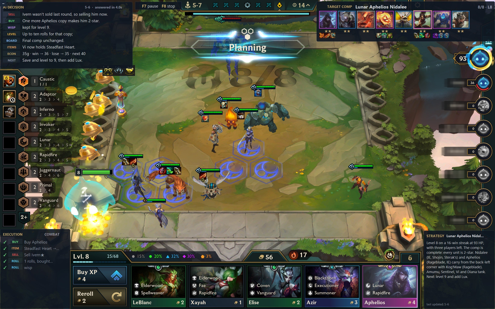
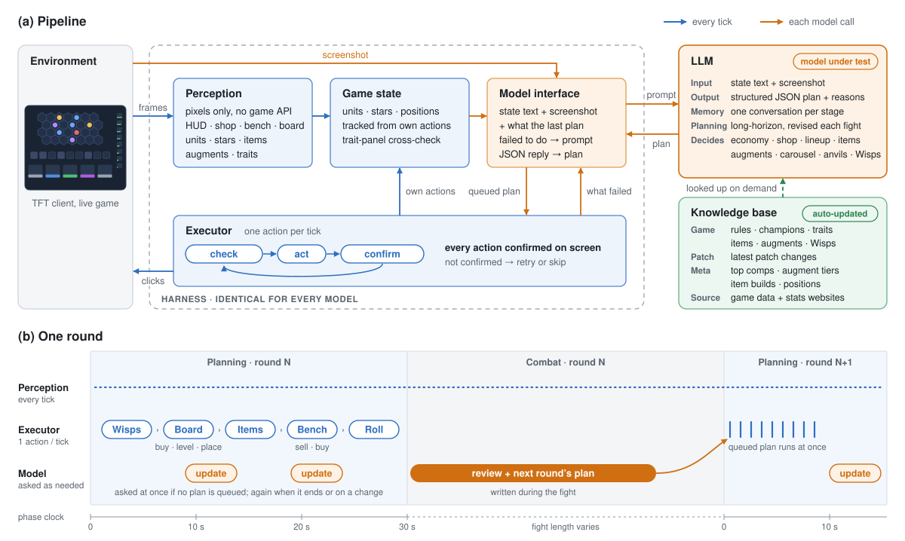
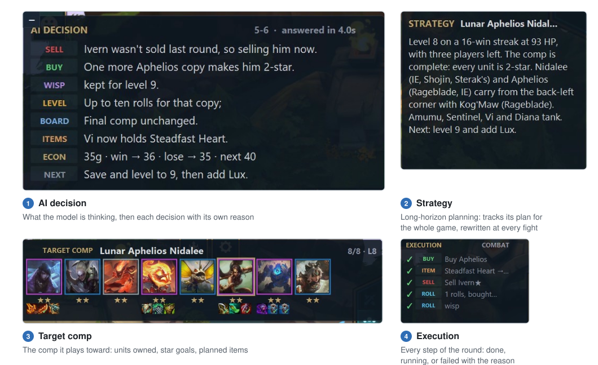

# TFT Harness

An agent harness for language models to play full games of Teamfight Tactics.

- **Bring your own model.** Claude, ChatGPT, or any model with an API key: plug it in and see how well it plays.
- **Patch-agnostic.** No strategy is hard-coded. The latest game data and meta stats load before every game, so a new
  patch needs no code change.
- **Interpretable.** Every decision comes with its reason, shown live over the game, and every prompt and answer is
  saved.

<p align="center">
  
</p>

## How it works

<p align="center">
  
</p>

**Figure 1.** **(a)** The framework around the model under test: game state from pixels, the model interface, the
executor and the knowledge base. **(b)** One round: the planning phase runs in a fixed order (Wisps, board, items,
bench, roll-down), and during the fight the model writes the next round's plan.

- **State.** The game is read from the screen. Every unit is tracked from the framework's own buys, moves and sells
  and checked against the screen (health bars, the trait panel); a unit's name comes from text, never from guessing a
  picture.
- **Questions.** The model is asked at each planning phase, at combat start, and at once when a timed choice appears
  (an augment, a Wisp, an anvil, the carousel). Each question carries the state, a screenshot and what the last plan
  failed to do.
- **Plans.** The model answers in a structured format: what to sell, buy, level and roll, where each unit stands,
  which items go where. It can write the next round's plan ahead and set standing orders (buy these champions whenever
  they show up). Nothing fills in for a missing answer.
- **Execution.** One action at a time: check that it still fits the game, act, confirm the effect on screen (a sell:
  the gold went up, the slot is empty). A step that does not take is retried, or reported back to the model.
- **Strategy and memory.** Before the game the model reads its comp and writes a strategy for the game, revised at
  every fight. Each stage starts a new conversation with a digest of the earlier ones; a game takes about 110 model
  calls, and one Claude Opus 5.5 game used 7.3M tokens and cost $5.90 at API prices.
- **Knowledge.** Game rules and data, patch notes and MetaTFT stats, refreshed before every game and looked up on
  demand.

<p align="center">
  
</p>

**Figure 2.** The overlay: **(1)** the model's reasoning and decisions, **(2)** its strategy for the game, **(3)** the
comp it is building, **(4)** every step and whether it worked. Also at `localhost:8765`.

## Running it

Windows 10 or 11, TFT and the League client in English (names are read as text), Python 3.11, Chrome or Edge, and
for a subscription Claude Code or Codex installed and logged in. Before each match the harness sets TFT to borderless
fullscreen (your settings are backed up).

```powershell
git clone https://github.com/fancy1026/tft-harness C:\tft-harness
cd C:\tft-harness
.\install.bat
.venv\Scripts\python tools\play.py
```

`play.py` asks for the model and the comp (a name from [metatft.com/comps](https://www.metatft.com/comps), or
`random`). To name them directly:

```powershell
.venv\Scripts\python tools\play.py "Riftbeast Pebbles" --model claude:claude-opus-5-5   # Claude subscription
.venv\Scripts\python tools\play.py "Riftbeast Pebbles" --model codex:gpt-6.1-sol        # ChatGPT subscription
.venv\Scripts\python tools\play.py "Riftbeast Pebbles" --model openrouter:<model id>    # API key: claude-key:, openai:, openrouter:
```

An API key is asked for once. `--effort
low|medium|high` sets how much the model reasons; `--games 3`, `--ranked`, `--no-screenshots` are optional. **F7**
pauses, **F8** stops all input. Each game is saved in `runs/` with every prompt, answer and screenshot.

## License

The code is under the [MIT license](LICENSE). Game data and icons are downloaded from CommunityDragon at install;
reference pictures cut from the game ship only as numeric fingerprints, except the four loot orb images in
`data/loot`. Those, the downloaded files and the screenshots in `media/` belong to Riot Games and are not covered by
the license.
